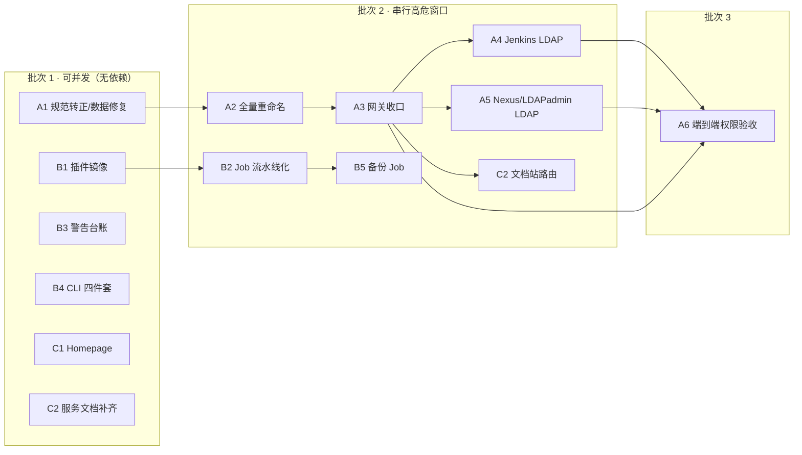

# M0 增量需求总表

> 状态：**已决策 / 待派单**（2026-11-05）
> 来源：用户 2026-11-05 的一批优化需求 + `grill-me` 决策树 A–F 全部收口结论。
> 地位：**本文是取证与编号索引，不是需求真本**。需求真本在 GitHub Issue（见 §6 映射表），
> 执行副本在 `docs/task-cards/<issue>-<slug>.md`，链路见 [派单流程](派单流程.md)。
> 决策真本：[身份命名规范](身份命名规范.md)（全量重命名唯一真源）、[账号与登录](账号与登录.md)（凭据交付）。

---

## 0. 决策摘要（A–F 收口，逐条钉死）

| 分支 | 决策 |
|---|---|
| **A** 历史改写 | 强删最后一个提交 `ef34ff0`，清本地对象与线上 LDAP 残留；接受 GitHub 侧 Commit API / Events / 缓存痕迹不可清除。**2026-11-05 已执行**（远端 main 曾回到 `02cdfc6`，线上 `uid=rdsw` 与 4 处 `memberUid` 归零，目录 33 条）。**⚠️ 2026-11-06 状态已被覆盖**：另一路并发会话以 `a923516` 重落 PR #82，把 `rdsw` 加回 `services/auth/ldif/*.ldif` 与相关文档/断言，并重新导入线上 LDAP；当前 main 与线上目录均为 **34 条**、`rdsw` 位于 `jira-admin` / `nexus-admin` / `gerrit-admin` / `jenkins-admin` 四组。**2026-11-06 16:45 用户裁决：再次彻底清除**。已执行：仓库侧 13 个文件（LDIF 2 份、bats 2 份、文档 9 份）+ 线上 `ldapdelete`（admin 绑定，先导全量 LDIF 备份）；`10_ldap.bats` 34→33、`posixAccount` 11→10。GitHub 侧旧 commit 仍可被 Commit API 返回，属已知不可清除残留。 |
| **B-架构** | **方案 C**：按服务拆 oauth2-proxy + 按组授权；Jenkins 摘出网关直连 LDAP；Nexus / phpLDAPadmin 直连 LDAP；Dex 保留为 IdP。 |
| **B-命名** | **全量重命名**，写 `docs/身份命名规范.md`；Git author `zeek.zhao <zeek.zhao@foxmail.com>` 是独立硬门禁，迁移不得改动。 |
| **B-口令** | **选项 1 去掉强制改密**：`{MD5}` → `{SSHA}`、口令值 `123456`、不做 ppolicy 首登改密；「明文」只体现在交付文档与 `orgflow-hosts.bat creds`。 |
| **B-网关收口** | **选项 1**：网关只守无原生认证能力的静态内容；`jenkins` / `ldapadmin` 摘掉 `auth: true` 直连 LDAP；文档站是唯一受保护路由；权限全部由 `posixGroup.memberUid` 决定。 |
| **C** Jenkins 工程化 | **全做**：自定义 image + 插件清单 + Job 流水线化 + 警告清零 + CLI 四件套。 |
| **D** Homepage / 文档 | **全做，走公开端点**：活性检测用不需凭据的 HTTP 探测；文档入口直链每份文档；天气用免 key 数据源。 |
| **E** Nexus 备份 | **Jenkins 上做参数化备份 Job**（「GeGinXX」按 Jenkins 解释），并补 Docker / GHCR 推送配置。 |
| **F** 项目管理 | **复用用户级 Project #5「orgflow-devops」，全部挂里程碑 M0**，不新建里程碑；再由 AI 并发领任务。 |

---

## 1. 网上资料核证（写需求前查过的，逐条标注证据强度）

| # | 结论 | 来源 | 强度 |
|---|---|---|---|
| 1 | Nexus **Community Edition 支持 LDAP**、Custom Access Controls、Remote Auth Token；Pro-only 的是 **SAML / Crowd / User Token**。所以「免费版不支持 LDAP」不成立，真正不支持的是 SAML SSO。 | Sonatype Feature Matrix | 官方 |
| 2 | oauth2-proxy `--allowed-group` 是**登录级**组限制，不是按服务 ACL；按服务授权要靠 `--set-xauthrequest=true` 输出的 `X-Auth-Request-Groups` 交给 `forward_auth` / `auth_request` 判定。 | oauth2-proxy 官方文档 | 官方 |
| 3 | `--reverse-proxy=true` 且未配 `--trusted-proxy-ip` 时，官方警告默认信任 `0.0.0.0/0`、`::/0`，可伪造 `X-Forwarded-*`。 | oauth2-proxy 官方文档 | 官方 |
| 4 | JCasC 支持 `jenkins.securityRealm.ldap`；默认 group membership filter `(\|(member={0})(uniqueMember={0})(memberUid={1}))` 与现有 `posixGroup.memberUid` 兼容；`java.naming.referral` 必须保持 `ignore`（设 `follow` 有凭据外泄 / SSRF 风险）。 | Jenkins LDAP plugin / JCasC 文档 | 官方 |
| 5 | 参数化构建：`POST JENKINS_URL/job/JOB_NAME/buildWithParameters`，`curl --user USER:TOKEN --data id=123 --data verbosity=high`；官方原话 **"API tokens are preferred instead of crumbs for CSRF protection."** | [Jenkins Remote Access API](https://www.jenkins.io/doc/book/using/remote-access-api/) | 官方逐字 |
| 6 | **该官方页没有逐字给出 `consoleText` / `api/json` 的 endpoint**，只说明 `.../api/` 模式与 wrapper 的 `progressiveText` 能力。因此 CLI 的 `get` / `log` 子命令必须在 213 运行时实测确认，**不得在文档里写成「官方文档规定」**。 | 同上 | 官方（否定结论） |
| 7 | Nexus 备份必须**数据库与 blob store 尽量同一时刻**备份；H2 部署有内置 `Admin - Backup H2 Database` 任务；PostgreSQL 部署用原生工具。 | [Sonatype Backup and Restore](https://help.sonatype.com/en/backup-and-restore.html) | 官方 |
| 8 | Homepage `siteMonitor` 是轻量 HTTP HEAD 监测（约 5 分钟一轮，记录状态码/延迟），**不需要凭据**；服务卡片另有 `ping` 字段。符合「走公开端点」。 | gethomepage 文档 / 配置实践 | 二手，实现时以容器版本实测为准 |
| 9 | Homepage 有 `openmeteo` 天气 provider（WMO code 映射）与 `customapi` widget（任意 JSON API + `mappings`）。 | gethomepage 源码/配置实践 | **二手**，实现时必须核容器内版本是否支持 |
| 10 | Open-Meteo 在**非商业 + <10,000 次/日**条件下，`api.open-meteo.com` **不需要 `apikey`**；当前天气走 `/v1/forecast?latitude=..&longitude=..&current=temperature_2m,...`。商业用才要 `customer-` 前缀 + key。 | [open-meteo.com/en/docs](https://open-meteo.com/en/docs) | 官方逐字 |

> 判据：凡标「二手」的结论，实现 Issue 必须带一条「容器内实测」验收，不得只凭资料直接改配置。

---

## 2. 213 现状取证（本轮 ssh 实测，不是推测）

| 事实 | 证据 |
|---|---|
| oauth2-proxy 零 `--allowed-group`、零 `--trusted-proxy-ip`、`--email-domain=*`、`--cookie-domain=.org-devops.com`、`--whitelist-domain=.org-devops.com` | `docker-compose.yml` 命令行段 |
| 这就是「一台机器随便一个账号登录后通吃所有服务」的直接成因 | 会话 cookie 全域 + 无组限制 |
| `config/routes.yaml` 只有 `jenkins` / `ldapadmin` 标 `auth: true`；`out/Caddyfile` 恰好 2 处 `forward_auth` | 读文件 |
| `config/jenkins.yaml` 仍是 `securityRealm.local` + `loggedInUsersCanDoAnything`（过宽） | 读文件 |
| 无 `Dockerfile` / `plugins.txt`，Jenkins 用官方镜像 + JCasC；5 类 Job（`backup/deploy/nexus/restore/verify`）由 JJB 定义，`make jobs` 推送 | 读目录 / `Makefile` |
| `users.ldif`：无盐 `{MD5}`；`admin.jira` 与 `dev.jira` 的 `uidNumber` 都是 `1009`；头注释 `Total Entries: 9` 实际 10 用户 + 1 OU；DN 是 `cn=<显示名>,...` | 读文件 |
| `app.ldif`：两处注释把 `cn=*-admin` 写成 `ou=gerrit`（dn 行本身对）；`gerrit.anonymous` 不属于任何组 | 读文件 |
| Homepage `widgets.yaml` 已有 `resources` / `datetime` / `search`，并写死约定「首页公开，不注入任何需要 token 的 widget」 | 读文件 |
| 文档真源已有 11 份 `docs/services/*.md` + `备份与恢复.md` + `使用说明.md` | `ls docs/services/` |
| 当前 `git status`：`docs/身份命名规范.md` 与 5 个 Homepage 配置文件为未跟踪；`main` = `02cdfc6` | `git status --short` |

---

## 3. 需求清单（13 条，编号即派工编号）

依赖列里的编号指**本表编号**；§6 回填 GitHub Issue 号。

### REQ-M0-A1 · 身份命名规范转正 + LDIF 数据缺陷修复

- **目标**：`docs/身份命名规范.md` 从「草案」转为已决策真本并进 git；LDIF 里与命名无关的硬缺陷清零。
- **资料依据**：§2 现状取证（uidNumber 冲突 / 注释失真 / `gerrit.anonymous` 无组 / 无盐 MD5）。
- **范围**：`docs/身份命名规范.md`（状态行 + 提交）、`services/auth/ldif/users.ldif`（uidNumber 唯一化、头注释、口令哈希改 `{SSHA}`）、`services/auth/ldif/app.ldif`（注释订正、`gerrit.anonymous` 归组）、`tests/bats/10_ldap.bats`（条目数/唯一性断言）、`README.md` 文档索引、`docs/账号与登录.md`（明文 `123456` 交付）。
- **验收**：`make test` 退出码 0；`awk` 检查 users.ldif 的 `uidnumber` 无重复；`grep -c '^dn:'` 与 bats 断言一致；`grep -c '{MD5}' users.ldif` → `0`；`grep -c '{SSHA}' users.ldif` → 用户数；**反证**：故意把两个 uidNumber 改回相同 → `10_ldap.bats` 必须红，恢复后复绿（贴两次输出）。
- **禁止**：不得改 Git author 门禁相关文件（`identity.yml` / hooks / `Makefile identity-check` / `docs/提交规范.md`）；不得此时改 uid 字符串（那是 A2）；不得改 `out/` 渲染产物。
- **依赖**：无。**批次 1**。

### REQ-M0-A2 · LDAP 全量重命名与口令迁移（高风险窗口）

- **目标**：所有用户 DN 与 uid 按 `docs/身份命名规范.md` §5 映射表完成迁移，口令统一 `{SSHA}` / `123456`，所有引用点同步，登录链路可回归。
- **资料依据**：§1 第 4 条（Jenkins LDAP 按 uid 搜索）、[身份命名规范](身份命名规范.md) §5 映射表、Dex `out/dex/config.yaml` 的 `userSearch.username=uid`。
- **范围**：`services/auth/ldif/*.ldif`、`services/auth/dex` 模板、`out/dex/config.yaml`（重渲染产物）、`tests/bats/10_ldap.bats`、`docs/账号与登录.md`、`windows orgflow-hosts.bat creds`、`config/routes.yaml` 若含 uid 引用。
- **验收**：`ldapsearch -x -H ldap://localhost -D "cn=admin,dc=devops,dc=com" -b "ou=users,dc=devops,dc=com" '(objectClass=posixAccount)' uid` 列出的 uid 与规范 §5 完全一致；每个 `posixGroup.memberUid` 都能解析到存在的 uid；`grep -r` 旧 uid 在 `docs/` `config/` `services/` `tests/` 中归零；**反证**：保留一个旧 uid 引用 → 全库 grep 必须报出；`make test` 绿。
- **禁止**：不得在 213 线上容器直接 `ldapmodify` 而不留回滚 LDIF；不得在 A3/A4/A5 未就绪时切生产入口；不得改 Git author。
- **依赖**：**A1**。**批次 2（串行，需单独窗口 + 回滚 LDIF）**。

### REQ-M0-A3 · oauth2-proxy 权限收口

- **目标**：消除「一个会话通吃所有服务」；网关按组授权，只守无原生认证的静态内容；伪造 `X-Forwarded-*` 不再可行。
- **资料依据**：§1 第 2、3 条；§2 现状。
- **范围**：`docker-compose.yml`（oauth2-proxy 参数：拆 `--allowed-group`、加 `--trusted-proxy-ip`、收紧 `--email-domain`、cookie 域按服务拆分或收窄）、`config/routes.yaml`（摘 `jenkins`/`ldapadmin` 的 `auth: true`）、`services/router/render.py` + 模板、`out/Caddyfile`（重渲染）、`tests/bats/` 新增权限用例、`docs/network` 或 `docs/services/oauth2-proxy.md` 说明。
- **验收**：`docker compose config | grep -c trusted-proxy-ip` ≥ 1；`grep -c 'forward_auth' out/Caddyfile` → `1`（只剩文档站）；**硬判据**：用非组成员账号完成 OIDC 后访问受保护路由必须被拒（贴 HTTP 状态码与响应体），组成员访问放行；**反证**：临时去掉 `allowed-group` → 非组成员用例必须红，恢复复绿。
- **禁止**：不得把 `--trusted-proxy-ip` 设成 `0.0.0.0/0`；不得靠 uid 里的 `admin`/`dev` 判权限；不得为过测试放宽断言。
- **依赖**：**A2**。**批次 2**。

### REQ-M0-A4 · Jenkins 直连 LDAP + 摘网关 + 组授权

- **目标**：Jenkins 只有一道登录，用 LDAP 账号 + `posixGroup` 组决定权限，不再有网关 OIDC + 本地 admin 双登录。
- **资料依据**：§1 第 4 条；§2（JCasC 现状 local + loggedInUsersCanDoAnything）。
- **范围**：`config/jenkins.yaml`（`securityRealm.ldap`、`authorizationStrategy` 改基于组/matrix、去掉 local users）、`config/routes.yaml`、`out/Caddyfile`、`docs/账号与登录.md`、`docs/services/jenkins.md`、Windows `orgflow-login.ps1`（双登录说明改为 LDAP 单登录）、`tests/bats/`。
- **验收**：`grep -c 'securityRealm' config/jenkins.yaml` 与 `grep -c 'ldap:'` 一致；**修改安全域前必须先在 Jenkins UI 跑 "Test LDAP settings"**（贴结果）；非组成员登录 Jenkins 后无权访问管理页；`https://jenkins.org-devops.com/` 不再 302 到 Dex；`orgflow-login.ps1` 更新后全绿；**反证**：把 `java.naming.referral` 改成 `follow` → 静态检查必须红。
- **禁止**：不得在未验证 LDAP 连通性时替换 `securityRealm`（会锁死 Jenkins）；不得保留 `loggedInUsersCanDoAnything`；不得把 LDAP admin 密码写进 JCasC 明文（走环境变量）。
- **依赖**：**A2、A3**。**批次 2**。

### REQ-M0-A5 · Nexus / phpLDAPadmin 直连 LDAP，文档站接成唯一受保护路由

- **目标**：Nexus CE 用内置 LDAP、phpLDAPadmin 用 LDAP bind，静态文档站是唯一走网关的路由。
- **资料依据**：§1 第 1 条（CE 支持 LDAP，SAML 才 Pro-only）、第 2、3 条。
- **范围**：`docs/services/nexus.md`（LDAP 配置步骤 + 说明 SAML 不可用及理由）、`docs/services/ldapadmin.md`、`config/routes.yaml`（新增 `docs` 路由 + `auth: true`）、`services/router/` 渲染、`out/Caddyfile`、`docs/账号与登录.md`。
- **验收**：`grep -c 'forward_auth' out/Caddyfile` → `1` 且对应 docs 路由；`curl --noproxy '*' --ssl-no-revoke -I https://nexus.org-devops.com/` 不再 302 到 Dex；Nexus UI 的 LDAP 连通测试通过（贴结果）；**反证**：把 docs 路由的 `auth: true` 去掉 → 权限用例必须红。
- **禁止**：不得把 Nexus SAML SSO 写进需求或文档（Pro-only）；不得改 `tests/images.lock` 的 digest。
- **依赖**：**A2、A3**。**批次 2**。

### REQ-M0-A6 · 端到端权限验收（非组成员必拒）

- **目标**：把「权限全部由组决定」变成可复跑的自动化用例集，替代人工点页面。
- **范围**：`tests/bats/` 新增权限矩阵用例（组 × 服务 × 允许/拒绝）、`docs/M0-验收记录.md` 追加一节、`Makefile` 若需新 target。
- **验收**：矩阵里每一格都有命令 + 期望状态码；至少 3 个「必拒」格；**反证**：给非组成员临时加 `memberUid` → 对应用例必须由红转绿；`make test-bats` 全绿。
- **依赖**：**A3、A4、A5**。**批次 3**。

### REQ-M0-B1 · 自定义 Jenkins image + 默认插件清单

- **目标**：Jenkins 镜像自带 pipeline 等常用插件，装机即可用，不靠人工 UI 点装。
- **范围**：新增 `services/jenkins/Dockerfile`、`services/jenkins/plugins.txt`；改 `docker-compose.yml`（build 段 / digest 锁定）、`docker-compose.ghcr.yml`、`tests/images.lock`、`Makefile`、`docs/M0-镜像与CI.md`。
- **验收**：`docker compose config` 能渲染；容器内 `jenkins-plugin-cli --list` 或 `ls /usr/share/jenkins/ref/plugins` 包含 `workflow-aggregator`、`git`、`credentials`、`ldap`、`configuration-as-code`；`grep -c 'workflow-aggregator' services/jenkins/plugins.txt` → `1`；**反证**：从 plugins.txt 删掉 `workflow-aggregator` → 镜像自检用例必须红。
- **禁止**：不得改 GHCR 已发布 tag 的内容（新增 tag）；不得在未锁 digest 时推送。
- **依赖**：无。**批次 1（可并发）**。

### REQ-M0-B2 · Job 流水线化，每一步可见

- **目标**：deploy / backup / restore / verify / nexus 五类 Job 改成 Pipeline，每个阶段有独立 stage 与日志分段，取代一长串不可分辨的 shell。
- **范围**：`config/job_definitions/` 五类定义、`shared-library/`、`Makefile jobs`、`docs/M0-最小核心.md`、`tests/bats/`。
- **验收**：`grep -rc 'stage(' config/job_definitions/` 每类 ≥ 2；`make jobs` 推送后 Jenkins 每类 Job 的构建页能看到 stage 列表（贴截图或 API 返回）；`tests/bats/` 的 verify job 一致性用例仍绿；**反证**：把某 stage 名字改成重复 → 静态检查报重名。
- **依赖**：**B1**（pipeline 插件）。**批次 1 后半 / 2**。

### REQ-M0-B3 · Jenkins 警告清零／不能解决的给理由

- **目标**：Manage Jenkins 页面警告逐条处置：能修的修掉，不能修的写进文档并说明原因。
- **范围**：新增 `docs/services/jenkins.md` 的「警告台账」段（编号 / 现象 / 处置 / 理由 / 复核日期）；相关 compose / JCasC / 反向代理配置。
- **验收**：在 213 抓 `/manage/` 与 `/administrativeMonitor/` 的警告列表（贴命令与输出）；台账条目数与实际警告数一致；每条有「已修」或「不修 + 理由」；**反证**：人为制造一条已知警告（如反向代理 URL 不匹配）→ 台账核对脚本必须报未登记。
- **禁止**：不得用隐藏/抑制警告的方式「清零」；不得改 Jenkins 版本来绕过。
- **依赖**：无。**批次 1（可并发，纯调研 + 文档）**。

### REQ-M0-B4 · Jenkins CLI 四件套（list / get / run / log）

- **目标**：一个命令行脚本完成「列任务、取任务详情、带参数触发、下载构建日志」，每步打印请求与结果。
- **资料依据**：§1 第 5 条（`buildWithParameters` + API token 免 crumb）、第 6 条（`consoleText` / `api/json` 必须实测，不冒充官方文档）。
- **范围**：新增 `scripts/jenkins-cli.sh` + `docs/services/jenkins.md` 用法段 + `scripts/` 自检用例。
- **验收**：`bash scripts/jenkins-cli.sh list` 列出 5 类 Job；`... get deploy` 返回 JSON 且含 job 名；`... run verify SERVICE=homepage` 返回 201/302 并打印 queue id；`... log deploy last` 输出非空构建日志；四条命令都在 213 实测贴输出；**反证**：故意用错 API token → 四个子命令必须都非 0 退出且打印明确错误，不得静默成功。
- **禁止**：不得把密码/token 写进脚本或日志（从 `.env` / 环境变量读）；不得用 crumb 作为首选（官方推荐 API token）；不得把 `consoleText` 写成「官方文档规定」。
- **依赖**：无。**批次 1（可并发）**。

### REQ-M0-B5 · Nexus 备份 Job + Docker / GHCR 推送配置

- **目标**：Jenkins 上有一个可参数化的 Nexus 备份 Job；镜像推送到 GHCR 的配置与凭据路径成文、可复跑。
- **资料依据**：§1 第 7 条（数据库与 blob store 同刻备份；H2 有内置 `Admin - Backup H2 Database` 任务）；[备份与恢复](备份与恢复.md) 现有约定。
- **范围**：`config/job_definitions/backup/` 或 `nexus/` 新增 Job、`shared-library/backupService`、`scripts/backup*.sh`、`docs/备份与恢复.md` 增 Nexus 章节、`docs/M0-镜像与CI.md` 增 GHCR 推送段、`.env.example`（不填真值）。
- **验收**：`make jobs` 后 Jenkins 出现该 Job 且参数可见；触发一次备份，产出物同时含数据库导出与 blob store 归档（贴文件清单 + 大小）；恢复演练能读回；GHCR 推送命令在文档里可直接照抄且用 `$GITHUB_TOKEN` 环境变量；**反证**：只备份数据库不备份 blob store → 校验脚本必须红。
- **禁止**：不得把 `GITHUB_TOKEN` 明文写进任何文件；不得覆盖现有备份产物；不得跳过恢复演练。
- **依赖**：**B2**。**批次 2**。
- **落地（2026-11-06）**：`config/job_definitions/nexus/nexus-backup.yaml`（Job `nexus-backup`，参数 `RETENTION_DAYS` / `RESTORE_DRILL` / `BOOT_CHECK`，已 `make jobs` 推送并确认参数可见）+ `shared-library/vars/nexusBackup.groovy` + `scripts/nexus-backup.sh` + `scripts/check_nexus_archive.py` + `scripts/test_nexus_archive.py`。
  213 后端取证为 **H2**（`/nexus-data/db/nexus.mv.db`），blob store 为 `blobs/default/`。
  **关键修复**：Nexus 自 #46 移出 compose 后，`backup.sh` / `restore.sh` 里的 `docker compose ps/stop/start nexus` 必然报 `no such service` —— **Nexus 备份链路当时是完全不通的**；已在 `scripts/backup-common.sh` 增加服务运行时抽象（nexus 走 `docker inspect/stop/start of-nexus`，容器名可用 `NEXUS_CONTAINER` 覆盖），`backup.sh` 另加内容级门禁（缺 db 或 blobs 直接删包报错）。
  实跑：包 **870441 B**（db 2076672 B + blobs 85 文件 / 830352 B），drill 卷 db sha256 一致、blobs 数与字节一致、临时 Nexus 20s 启动 HTTP 200；反证只 db / 只 blobs 均 RC=1，全量包 RC=0。

### REQ-M0-C1 · Homepage 活性检测 + 时间/天气/界面 + 文档直链

- **目标**：首页能看到每个服务的存活状态、时间、天气；每份文档有可直接点开的链接，并写清「怎么用」。
- **资料依据**：§1 第 8、9、10 条；§2（首页公开、现有 widgets 约定）。
- **范围**：`config/homepage/widgets.yaml`（`siteMonitor` / 服务 `ping` / `openmeteo` 或 `customapi` 天气 / `datetime`）、`services.yaml`（每卡加文档 href）、`bookmarks.yaml`（本地文档区）、`settings.yaml`、`docs/services/homepage.md`。
- **验收**：`docker compose --env-file .env exec -T homepage` 内确认所用 widget 类型在当前镜像版本存在（**二手资料必须实测**）；首页 HTTP 200 且 6 个服务卡显示状态；天气请求 URL 不含 `apikey`；`grep -c 'docs/' config/homepage/services.yaml` ≥ 服务数；**反证**：停掉 `of-nexus` → 首页对应状态必须变为 down，恢复后变 up（贴两次）。
- **禁止**：不得注入任何需要 token/凭据的 widget（首页公开）；不得使用需要 API key 的天气服务；不得破坏 bookmark 值必须是列表的约束（`new URL(e.href)` 会炸）。
- **依赖**：无。**批次 1（可并发）**。

### REQ-M0-C2 · 文档站静态路由 + 每份服务指南补齐

- **目标**：`docs/` 通过 Caddy 静态路由对外可访问；11 份服务文档统一补齐「使用指南 / 注意事项 / 设置 / 备份」四段；Homepage 从每条链接直达对应段落。
- **范围**：`config/routes.yaml`（docs 路由）、`services/router/` 渲染、`out/Caddyfile`、新增静态站点生成脚本（把 `docs/*.md` 编成 HTML 或直接用文件服务）、`docs/services/*.md` 11 份、`docs/备份与恢复.md`、`README.md` 索引。
- **验收**：`curl --noproxy '*' --ssl-no-revoke -I https://docs.org-devops.com/services/jenkins.html` → 200；11 份文档逐份 `grep -c '^## '` ≥ 6（含四段）；`make test` 的文档覆盖自检绿；**反证**：删掉某份文档的一段 → 覆盖自检必须红。
- **禁止**：不得把含明文口令的内容放进公开文档站（该站虽受网关保护，仍按最小披露）；不得改 `docs/` 里已有的验收记录结论。
- **依赖**：**A3**（文档站是唯一受保护路由，但文档内容补齐可先做）。**批次 1（文档部分可并发）**。

---

## 4. 依赖链与并发批次

**硬规则**：A2 是唯一会改动所有服务登录标识的窗口，必须单独执行、带回滚 LDIF，
且 A3/A4/A5 不得与它并行——否则会出现「LDAP 已改名、网关还在按旧组判权」的中间态。

---

## 5. 风险与不能自动化的部分

| 风险 | 处置 |
|---|---|
| 替换 Jenkins `securityRealm` 可能锁死管理员 | A4 强制先跑 UI "Test LDAP settings"，并保留本地 admin 应急回退步骤 |
| `down -v` 会重建 Caddy 内部 CA，Windows 客户端需重装根证书 | 本批需求**不执行** `down -v`；如需重建，单独走 `docs/使用说明.md` 的证书分发流程 |
| 明文 `123456` 是初始口令 | 仅在交付文档 / `orgflow-hosts.bat creds` 明文；LDIF 内 `{SSHA}`；不做 ppolicy 强制改密（用户决策），在账号文档标注「内网演示环境，上线前须换」 |
| Homepage 天气/活性 widget 的资料是二手 | C1 验收强制容器内实测 widget 类型，实测不支持就降级为 `customapi` + Open-Meteo，不得硬写 |
| Jenkins `consoleText` / `api/json` 官方文档未逐字列出 | B4 必须在 213 实测，文档里标「运行时确认」 |
| GitHub 侧旧提交痕迹 | A 分支已接受不可清除；不再尝试删除 |
| 需要人工的动作 | Jenkins UI LDAP 测试、Nexus UI LDAP 连通测试、局域网另一台机器的人工浏览器验收（既有 #65） |

---

## 6. Issue 映射表（推送后回填）

| 需求编号 | GitHub Issue | 里程碑 | Project | 任务卡 |
|---|---|---|---|---|
| REQ-M0-A1 | [#84](https://github.com/zeek-zhao/orgflow-devops/issues/84) | M0 | #5 | [卡](task-cards/84-identity-naming.md) |
| REQ-M0-A2 | [#85](https://github.com/zeek-zhao/orgflow-devops/issues/85) | M0 | #5 | 待批次 2 |
| REQ-M0-A3 | [#86](https://github.com/zeek-zhao/orgflow-devops/issues/86) | M0 | #5 | 待批次 2 |
| REQ-M0-A4 | [#87](https://github.com/zeek-zhao/orgflow-devops/issues/87) | M0 | #5 | 待批次 2 |
| REQ-M0-A5 | [#88](https://github.com/zeek-zhao/orgflow-devops/issues/88) | M0 | #5 | 待批次 2 |
| REQ-M0-A6 | [#89](https://github.com/zeek-zhao/orgflow-devops/issues/89) | M0 | #5 | 待批次 3 |
| REQ-M0-B1 | [#90](https://github.com/zeek-zhao/orgflow-devops/issues/90) | M0 | #5 | [卡](task-cards/90-jenkins-plugins.md) |
| REQ-M0-B2 | [#91](https://github.com/zeek-zhao/orgflow-devops/issues/91) | M0 | #5 | 待批次 2 |
| REQ-M0-B3 | [#92](https://github.com/zeek-zhao/orgflow-devops/issues/92) | M0 | #5 | [卡](task-cards/92-jenkins-warnings.md) |
| REQ-M0-B4 | [#96](https://github.com/zeek-zhao/orgflow-devops/issues/96) | M0 | #5 | [卡](task-cards/96-jenkins-cli.md) |
| REQ-M0-B5 | [#93](https://github.com/zeek-zhao/orgflow-devops/issues/93) | M0 | #5 | ✅ 已完成（2026-11-06） |
| REQ-M0-C1 | [#94](https://github.com/zeek-zhao/orgflow-devops/issues/94) | M0 | #5 | [卡](task-cards/94-homepage-widgets.md) |
| REQ-M0-C2 | [#95](https://github.com/zeek-zhao/orgflow-devops/issues/95) | M0 | #5 | [卡](task-cards/95-service-docs.md) |

> 既有 open Issue（#61 / #62 / #63 / #65 挂 M0，#60 挂 M1）保持不变，不与本批合并。
> 本表与 `docs/待办.md` 同步；Issue 是需求真本，本表不复述 Issue 正文。
