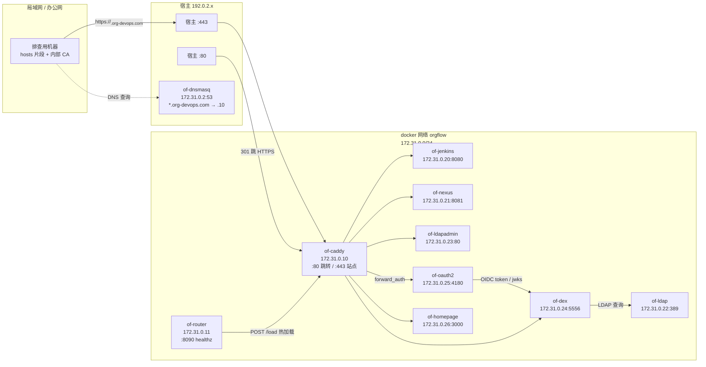
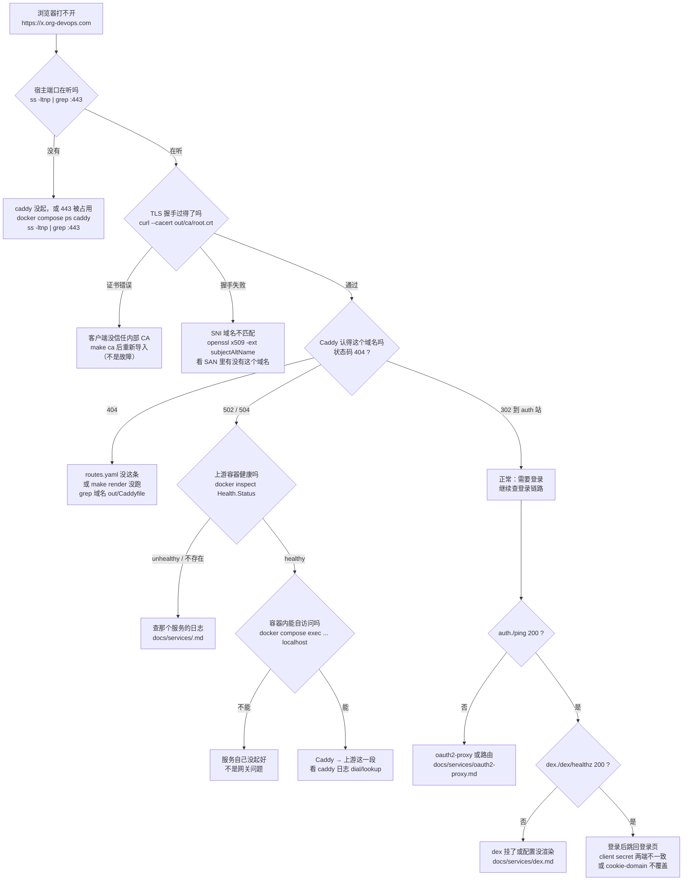

# 生产网络架构

一页纸回答三个问题：**请求从哪来、经过谁、坏了查哪一层。**

## 拓扑



**读图要点**

- **只有 caddy 发布宿主端口**（80/443）。其它容器一律 `expose`，宿主上连不上——
  这是刻意的，绕过网关就等于绕过鉴权
- **认证链路是斜的**：`caddy → oauth2-proxy → dex → ldap`。登录失败卡在这条链的某一环
- **router 不转发业务流量**，它只往 caddy 灌配置
- **dnsmasq 不在请求路径上**，但所有容器启动时都依赖它解析域名

## 固定 IP 分配表

| IP | 服务 | 端口 | 域名 | 需要登录 |
|---|---|---|---|---|
| `172.31.0.2` | dnsmasq | 53 | — | — |
| `172.31.0.10` | caddy | 80 / 443 | 所有站点 | — |
| `172.31.0.11` | router | 8090 | — | — |
| `172.31.0.20` | jenkins | 8080 | `jenkins.<domain>` | 是 |
| `172.31.0.21` | nexus | 8081 | `nexus.<domain>` | 否 |
| `172.31.0.22` | ldap | 389 | — | — |
| `172.31.0.23` | ldapadmin | 80 | `ldapadmin.<domain>` | 否 |
| `172.31.0.24` | dex | 5556 | `dex.<domain>` | 否 |
| `172.31.0.25` | oauth2-proxy | 4180 | `auth.<domain>` | — |
| `172.31.0.26` | homepage | 3000 | `home.<domain>` | 否 |

`172.31.0.1` 是 docker 网关，不要占。`jjb` 用 host 网络，没有固定 IP。

`<domain>` 默认 `org-devops.com`，由 `GATEWAY_DOMAIN` 决定。

**这张表是会被脚本核对的**——`bash scripts/check-arch-ips.sh` 逐行比对真实容器地址，
不一致就非 0 退出。手改表或改 compose 后记得跑一次。

## 分层排查决策树

**先定位在哪一层，再进那一层。** 不要从最里层开始试——里层通、外层不通的时候，
你在里层怎么试都是对的，会浪费时间。



**四层速查**

| 层 | 一句话判据 | 失败时的典型误判 |
|---|---|---|
| 宿主端口 | `ss -ltnp \| grep :443` 有 docker-proxy | 以为是应用问题，其实端口被 nginx 占了 |
| Caddy 路由 | `curl -k` 返回 200/302，不是 404 | 以为证书问题，其实是没这个站点 |
| 上游连通 | `docker compose exec caddy wget http://<svc>:<port>` | 看到 `502` 就去查应用，其实是 DNS |
| 服务内部 | `docker compose exec <svc> curl localhost` | 在这里反复试，而外层根本没通 |

## 局域网访问

局域网机器要访问 `https://jenkins.org-devops.com`，需要两件事：**域名解析** + **信任内部 CA**。

### 1. 域名解析

方案 A（推荐）：生成 hosts 片段分发

```bash
make hosts                      # 自动探测宿主 IP
make hosts IP=192.168.1.50      # 或显式指定
```

产物是 `out/hosts`，内容形如：

```
192.168.1.50  jenkins.org-devops.com nexus.org-devops.com ldapadmin.org-devops.com
192.168.1.50  dex.org-devops.com auth.org-devops.com home.org-devops.com
```

贴进各机器的 hosts 文件（Windows: `C:\Windows\System32\drivers\etc\hosts`，
Linux/macOS: `/etc/hosts`）。

方案 B：把 dnsmasq 的 53 端口发布到局域网，客户端 DNS 指过来。M0 没这么做——
多一台 DNS 就多一处要维护，而且 UDP 53 在办公网常被拦。

### 2. 信任内部 CA

```bash
make ca      # 导出 out/ca/root.crt
```

- **Linux**：`sudo cp out/ca/root.crt /usr/local/share/ca-certificates/orgflow.crt && sudo update-ca-certificates`
- **macOS**：双击导入「钥匙串访问」→ 系统 → 始终信任
- **Windows**：双击 → 安装证书 → 本地计算机 → 受信任的根证书颁发机构
- **Firefox**：它用自己的证书库，要在「隐私与安全 → 证书 → 查看证书 → 导入」里单独加

不导入也能用（浏览器点「继续访问」，curl 加 `-k`），但每次都要点一次。

### 3. 「能 ping 不能开」的常见原因

| 现象 | 原因 | 验证 |
|---|---|---|
| `ping` 通但浏览器超时 | 宿主防火墙挡了 443 | `ss -ltnp \| grep :443` 在听但外部连不上 → 查 `ufw` / `firewalld` |
| 能开但证书警告 | 没导入内部 CA | `curl --cacert out/ca/root.crt` 能过就是这个问题 |
| 解析到别的 IP | 本机 DNS 缓存或 hosts 有旧条目 | `nslookup jenkins.org-devops.com` 对比 hosts 文件 |
| 打开是别的网站 | hosts 里这个域名指到了别处 | 同上 |
| `ERR_CONNECTION_REFUSED` | 容器没起，或 `GATEWAY_HTTPS_PORT` 不是 443 | `docker compose ps caddy`，看 `.env` |
| 登录后跳回登录页 | cookie 域名不覆盖当前访问方式 | 用域名访问，不要用 IP 访问——cookie 是按域名设的 |

**用 IP 访问会坏很多事**：cookie 按域名设、TLS 证书按 SAN 签、Caddy 按 Host 头选站点。
排查时如果需要绕开 DNS，用 `curl --resolve` 而不是直接访问 IP。

## 和代码的对应关系

| 架构元素 | 真源文件 |
|---|---|
| 固定 IP | `docker-compose.yml` 的 `ipv4_address` |
| 站点与上游 | `config/routes.yaml` |
| 认证站点 | `config/routes.yaml` 里 `name: auth` 那条 |
| 域名后缀 | `.env` 的 `GATEWAY_DOMAIN` |
| 宿主端口 | `.env` 的 `GATEWAY_HTTP_PORT` / `GATEWAY_HTTPS_PORT` |

改了这些之后，`docs/network/arch.md` 的表格要同步——`scripts/check-arch-ips.sh` 会替你发现遗漏。
