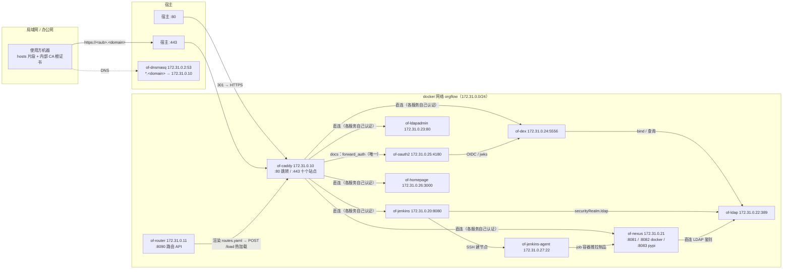
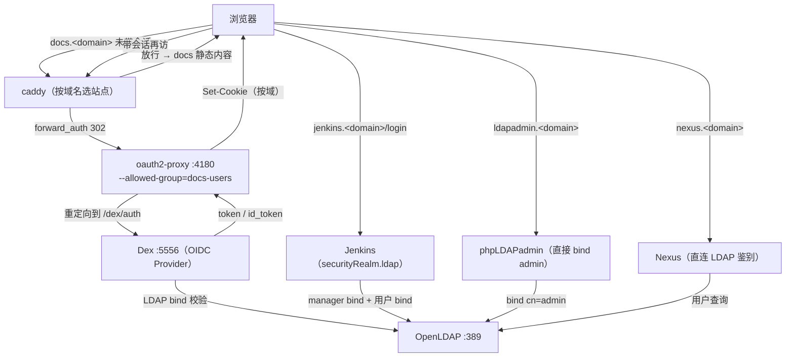
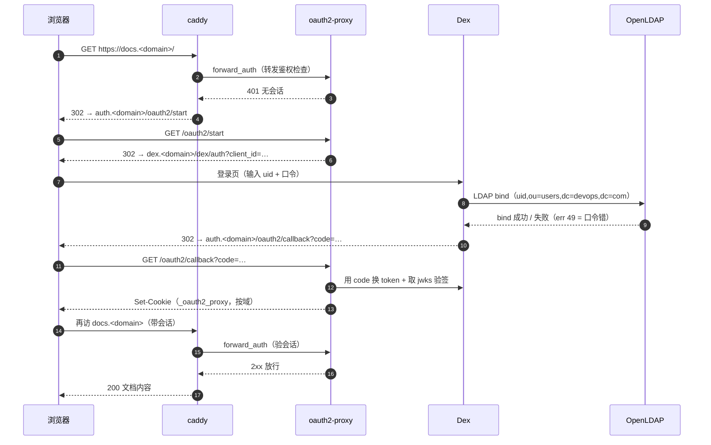

# 架构图（网络生产架构 / 认证架构 / 登录认证时序）

> **读者**：想一眼看懂这套平台怎么连、怎么登录的新人，以及排查时需要「对图定位」的人。
> 本文是**图的唯一真源**；文字版架构说明、固定 IP 分配表与排查决策树在
> [生产网络架构](arch.md)。IP 表有脚本核对（`bash scripts/check-arch-ips.sh`），
> 本文的图若与表冲突，以表为准并修图。
>
> 域名后缀 `<domain>` 默认 `org-devops.com`（`.env` 的 `GATEWAY_DOMAIN`）。

## 0. 演示环境口令与账号总表

这套平台按**演示包**交付：口令有两条路线——**演示模式用下表的固定值**，
**开发/生产模式由 `deploy` 在 `.env` 不存在时随机生成**（写回部署机的 `.env`，
权限 0600，不入库、不打印）。演示模式开关（`ENV_NAME=demo`）实施中，见
[问题索引](../project/问题索引.md)；当前仓库行为的真源是
[使用说明 §0](../engineering/使用说明.md)。

### 服务口令（.env 键）

| .env 键 | 演示模式固定值 | 属主 | 说明 |
|---|---|---|---|
| `ORGFLOW_INITIAL_PASSWORD` | `OrgflowDemo2026` | 10 个 LDAP 账号 | LDAP 用户初始口令；`make ldap-apply` 同步 |
| `LDAP_ADMIN_PASSWORD` | `OrgflowLdapAdmin2026` | LDAP 目录管理员 | `cn=admin,dc=devops,dc=com` |
| `NEXUS_ADMIN_PASSWORD` | `OrgflowNexusAdmin2026` | Nexus `admin` | 由 `nexus-deploy.sh` 完成初始改密 |
| `OAUTH2_CLIENT_SECRET` | `OrgflowOauth2Demo2026` | oauth2-proxy ⇄ Dex | 两端必须一致 |
| `OAUTH2_COOKIE_SECRET` | `OrgflowCookieDemoSecret2026ABCDE` | oauth2-proxy | 会话 cookie 签名（32 字符） |

### 登录账号（从哪进、用什么登）

| 入口 | 域名 | 账号 | 口令来源 | 认证方式 |
|---|---|---|---|---|
| Jenkins | `jenkins.<domain>` | `svc-platform-admin` | `ORGFLOW_INITIAL_PASSWORD` | LDAP realm（直连，不走网关） |
| phpLDAPadmin | `ldapadmin.<domain>` | `cn=admin,dc=devops,dc=com` | `LDAP_ADMIN_PASSWORD` | LDAP bind（直连，不走网关） |
| Nexus | `nexus.<domain>` | `admin` | `NEXUS_ADMIN_PASSWORD` | Nexus 本地账号 |
| 文档站 | `docs.<domain>` | `svc-platform-dev`（docs-users 组） | `ORGFLOW_INITIAL_PASSWORD` | **唯一走网关认证的路由**（OIDC） |
| 门户 | `home.<domain>` | 无需登录 | — | 公开（不得注入需凭据的 widget） |
| CA 分发 | `ca.<domain>` | 无需登录 | — | 公开（`/root.crt`） |
| Docker / PyPI | `docker.<domain>` / `pypi.<domain>` | Nexus 侧账号 | `NEXUS_ADMIN_PASSWORD` | Nexus connector |
| Dex / oauth2-proxy | `dex.<domain>` / `auth.<domain>` | 不直接登 | — | 只为登录链路服务 |

> 10 个 LDAP 账号全清单见 [services/ldap.md](../services/ldap.md)；DN 统一为
> `uid=<uid>,ou=users,dc=devops,dc=com`（**不是** `ou=people`）。

## 1. 网络生产架构图

读法：**只有 caddy 发布宿主端口**，其它容器一律 `expose`；认证链路是斜的
（`caddy → oauth2-proxy → dex → ldap`）；router 只往 caddy 灌配置，不转发业务流量。

十个站点域名的真源是 `config/routes.yaml`：`home / jenkins / nexus / ldapadmin /
dex / auth / docs / ca / docker / pypi`。Nexus 不在 compose 里（#46），由
`nexus-deploy.sh` 拉起，IP 与别名不变（见 [arch.md](arch.md) 的表）。

## 2. 认证架构图

三条认证路径，各归各主——**没有全局 SSO 兜底**，谁自己能认证就谁认证：

| 路径 | 谁在守 | 组/账号真源 |
|---|---|---|
| `docs` | caddy forward_auth → oauth2-proxy | LDAP `posixGroup` `docs-users`（`memberUid`） |
| `jenkins` | Jenkins 自身 LDAP realm | LDAP 组（[jenkins.md](../services/jenkins.md)） |
| `ldapadmin` | phpLDAPadmin 自身 | `LDAP_ADMIN_PASSWORD` |
| `nexus` | Nexus 自身 | Nexus 内部账号 / LDAP |
| `home` `ca` `dex` | 公开 | — |

伪造 `X-Forwarded-*` 头绕不过网关：oauth2-proxy 只信任来自 caddy 容器网段的
`trusted-proxy-ip`（`36_gateway_acl.bats` 有断言）。

## 3. 登录认证时序图（以文档站为例）

一次完整 OIDC 登录的九步。卡在哪一步，就去那一环的 [services/](../services/) 手册：

排障口诀：**登录失败先看跳到了哪**——
302 回登录页 = secret/cookie 域不一致；卡在 Dex 登录页 = LDAP bind 失败
（`err 49` 口令错，`err 32` DN 不存在）；`/ping` 都不通 = oauth2-proxy 本身没起。
完整决策树见 [arch.md §分层排查](arch.md)。

## 关联

| 想了解 | 去 |
|---|---|
| 文字版架构 + 固定 IP 表 + 排查决策树 | [生产网络架构](arch.md) |
| 路由模型为什么改成域名 | [ADR-13](../records/ADR-13-域名路由.md) |
| 每个服务的需求 × 测试对应 | [服务×需求×测试矩阵](../engineering/服务×需求×测试矩阵.md) |
| 口令与账号的运维细节 | [使用说明](../engineering/使用说明.md)、[services/ldap.md](../services/ldap.md) |

