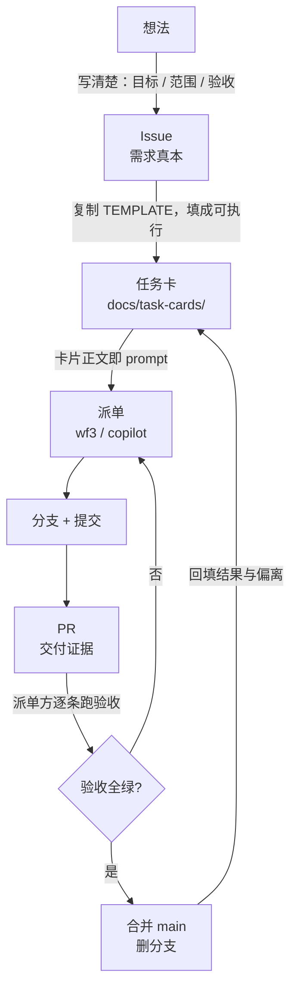

# 派单流程

从「有个需求」到「代码合进 main」的固定链路。**每一步的产物都是下一步的输入**，
跳步就会出问题：跳过卡片直接口头派单，验收口径就散了；跳过验收直接合并，回归就没人挡。



## 三个产物的分工

| 产物 | 是什么 | 谁写 | 地位 |
|---|---|---|---|
| **Issue** | 需求本身：为什么做、边界在哪、怎么算做完 | 派单方 | **真本**。卡片与 PR 都以它为准 |
| **任务卡** | 一次可派单的最小工作单元，可直接当 prompt | 派单方 | 副本。引用 Issue，不复述结论 |
| **PR** | 交付证据：做了什么、怎么验的、哪里没验 | 执行方 | 证据。验收输出必须原样贴，不能转述 |

**Issue 与卡片冲突时，以 Issue 为准。** 卡片的职责是把 Issue 翻译成「执行方读完就能开工」的形式，
不是重新定义需求。

## 链路七步

### 1. 写 Issue

用 `.github/ISSUE_TEMPLATE/task.yml`（新建 Issue 时自动套用）。必填：目标、范围、验收、禁止。

验收写不出可执行命令，说明需求还没想清楚——**这时候不要开工**。

### 2. 建分支

```bash
git checkout main && git pull
git checkout -b feat/<issue>-<slug>     # feat/16-public-images
```

分支名里的 `<issue>` 是数字。合并后删除分支。

### 3. 填卡片

```bash
cp docs/task-cards/TEMPLATE.md docs/task-cards/<issue>-<slug>.md
```

按 `TEMPLATE.md` 的字段填。填完自查三问：

1. **执行方读不到本仓库之外的任何上下文** —— 卡片里有没有「上次说的那个」这类指代？
2. **每条验收都能照抄执行** —— 有没有「功能正常」这类不可执行的条目？
3. **有没有反证条目** —— 只有「跑绿」的卡，无法区分「真做对了」和「断言没生效」。

### 4. 派单

卡片正文直接作为 prompt 投递。示例（`ai-workflow` 的 WF3）：

```bash
copilot-dev.sh <workdir> <卡片文件路径> <日志路径> <session>
```

要点：

- **卡片全文投递**，不要摘要。摘要会丢掉「禁止事项」和「前置条件」
- 日志与 session 名带上 issue 号，便于回看
- 执行方问出卡片已回答的问题 → 卡片有歧义，**先改卡再派**，不要口头补

### 5. 执行方交付

要求（写进每张卡的「交付物」）：

- 分支 + 提交（提交信息符合 `docs/提交规范.md`，author 恒为 `zeek.zhao <zeek.zhao@foxmail.com>`）
- PR 正文四段：做了什么 / 关键决策与偏离 / 验收实测表 / 未验证项
- 验收输出**原样贴**，不转述

### 6. 派单方验收

**不要只看 PR 里的绿字，自己跑一遍。**

```bash
git fetch && git checkout <分支>
make test            # 76 项纯逻辑测试
make test-bats       # DinD 内 21 条用例
```

再逐条对照卡片的验收表。特别要跑**反证条目**——它们是唯一能证明断言真的生效的东西。

验收不通过就退回，**不要「先合并再修」**：合并后的修复会失去反证的机会。

### 7. 合并与回填

- PR 正文含 `Closes #<issue>`，合并后 Issue 自动关闭
- 合并方式 Squash / Rebase，合完删分支
- 回到卡片补「交付后的记录」：PR 号、结果、**与本卡的偏离**

最后一项最容易被跳过，但它决定这张卡下次还能不能用——偏离不记录，下一张卡就会
基于过期的假设派单。

## 卡片索引

| 卡 | Issue | PR | 内容 |
|---|---|---|---|
| [01](task-cards/01-router-render.md) | #1 | #6 | 路由注册服务：YAML → Caddyfile 渲染 + 热加载 |
| [02](task-cards/02-auth-stack.md) | #2 | #7 | 权限管理服务：OpenLDAP + LDAP Admin + Dex + OAuth2 Proxy |
| [03](task-cards/03-param-jobs.md) | #3 | #8 | 参数化 deploy / backup Job（JJB + 共享库） |
| [04](task-cards/04-bootstrap-deploy.md) | #4 | #9 | Jenkins 自举一键部署（Makefile / deploy.sh） |
| [05](task-cards/05-backup-restore.md) | #5 | #10 | 备份与恢复（脚本 + 保留策略 + 手册） |
| [06](task-cards/06-bats-dind.md) | #11 | #13 | 测试体系：bats + DinD + digest 锁定 |
| [07](task-cards/07-ci-ghcr.md) | #12 | #14 | CI：Actions 构建镜像推 GHCR + 跑 bats |

这七张是**回溯重建**的：当时的派单用的是临时文件（`TASK-BATS-11.md`、`.issue-6.md` 之类），
用完即删，没有留档。重建时按「当前仓库里真实存在的测试和命令」写验收，
每张卡的末尾记了「当年实测」和「与本卡的偏离」——两处不一致的地方就是这期间系统演进的地方，
比卡本身更有信息量。

## 常见失败模式

| 现象 | 根因 | 处置 |
|---|---|---|
| 执行方反复问「你说的 X 是哪个文件」 | 卡片缺「范围（逐文件）」 | 补文件清单，重派 |
| 交付物「看起来都对」但合进去就坏 | 卡片没有反证条目，断言从未被验证过 | 补反证，重跑 |
| 改了不该改的文件 | 卡片「禁止事项」写的是「不要乱改」 | 改成具体的「不得改 `<文件>`」 |
| 环境不满足时自行绕过，产出不可信的「成功」 | 缺「依赖与前置」，或前置不可执行 | 补可执行的前置检查 |
| 在一条走不通的路上烧光预算 | 缺 token 预算 | 写预算，并要求超预算先汇报 |
| 同一件事反复派单，每次做法都不一样 | 卡片没回填「与本卡的偏离」 | 验收后必须回填 |

## 与本仓库其它文档的关系

| 文档 | 关系 |
|---|---|
| `docs/提交规范.md` | 卡片「交付物」里引用的提交与身份规则 |
| `docs/M0-最小核心.md` | 服务与参数的支持边界，卡片「背景与取证」的事实来源 |
| `docs/M0-测试体系.md` | 卡片验收命令里 `make test-bats` 的实现说明 |
| `docs/M0-镜像与CI.md` | 卡片验收里 GHCR 相关的取证方式 |
